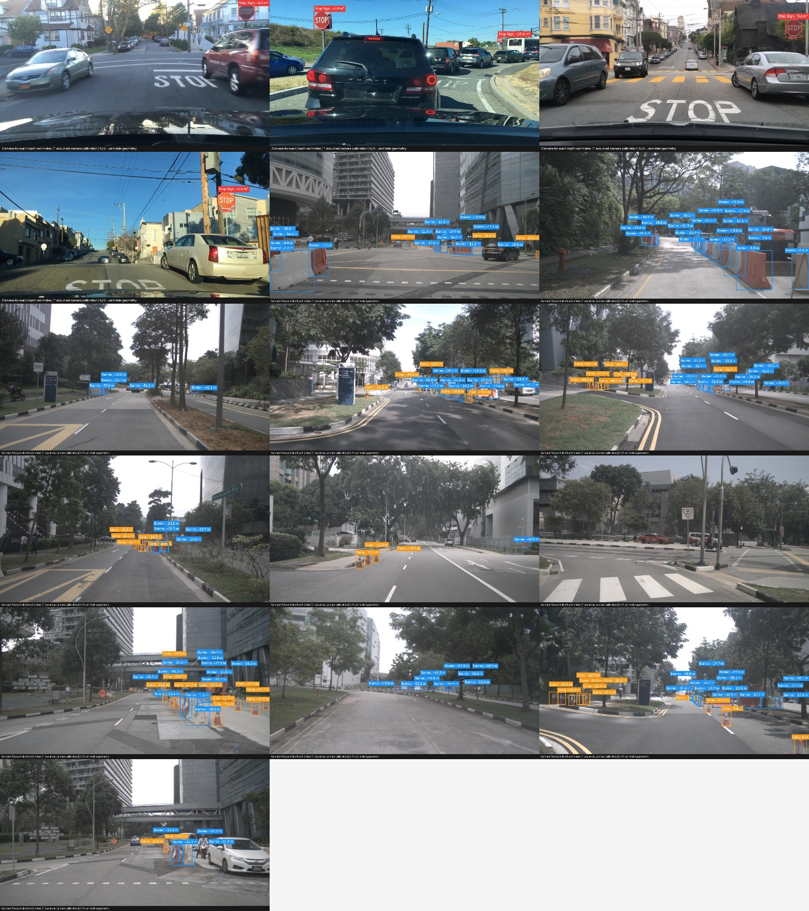

# Object Detection and Geometric Distance Estimation

**Author: Kartik Sakhuja** | ERIC Robotics Machine Learning Assignment

Fine-tunes a COCO-pretrained YOLO11n detector for `cone`, `barrier`, and `stop_sign`. Dataset images provide the entire workflow, including the demonstration. Camera calibration from nuImages supports a ground-plane depth estimate; images without calibration use explicitly marked assumptions. CPU/GPU and OpenVINO FP32/INT8 comparisons measure the same input size and report both accuracy and latency.

## Status and results

The implementation, 30-epoch training run, held-out tests, exports and benchmarks are complete. Baseline test **mAP50: 0.7136; mAP50–95: 0.4567**. Annotated-pipeline speed was **13.68 FPS** on PyTorch CPU FP32, **30.92 FPS** on GPU FP32, **24.37 FPS** on OpenVINO CPU FP32 and **32.01 FPS** on OpenVINO CPU INT8. INT8 provided **1.31×** speed versus OpenVINO FP32, with a **0.0089** absolute mAP50–95 reduction. GPU FP16 was slightly slower in this experiment, so GPU FP32 remains the demonstration default.

See [the full measured report](outputs/report.md), [training curves](outputs/training_curves.png), [machine-readable metrics](outputs/metrics), and [submission steps](SUBMISSION_CHECKLIST.md). No distance-accuracy score is claimed because these 2D annotations provide no object-distance ground truth. This is a prototype evaluated on a limited custom subset.

For an explanation of the work, decisions and results, read [my project documentation](PROJECT_DOCUMENTATION.md).



[Dataset slideshow](outputs/demo/dataset_slideshow.mp4) | [Optional bird's-eye road view](outputs/bev/road_bev.jpg)

## Dataset and annotation decisions

BDD100K's standard detection annotations use the generic category `traffic sign`; that category is **not** a stop-sign label. Cones and barriers come from nuImages' `movable_object.trafficcone` and `movable_object.barrier` categories. Stop signs use visually reviewed BDD traffic-sign boxes, plus an audit of incidental stops in the selected nuImages frames.

A pretrained detector proposes candidates, then the assistant visually checks contact sheets. No-entry, yield, direction arrows, sign backs and ambiguous candidates are rejected. Recognizable international red octagonal raised-hand stop signs are included. BDD boxes inherit the official localization; the 14 supplemental nuImages stop boxes inherit teacher-model localization with visual class verification. This is a custom subset with model-assisted annotation, rather than an official stop-sign benchmark. The candidate selection can miss signs; annotation coverage is incomplete. All selected images contain at least one target object, so performance on entirely negative scenes is not established.

| Split | Image entries | Cone boxes | Barrier boxes | Stop-sign boxes |
|---|---:|---:|---:|---:|
| Train | 1,224 | 4,152 | 5,630 | 301 |
| Validation | 177 | 578 | 892 | 32 |
| Test | 165 | 783 | 795 | 18 |

There are 1,300 unique nuImages frames and 70 unique BDD frames. The 28 BDD training frames repeat eight times to reduce class imbalance; image hardlinks avoid additional image storage. Validation/test images are never repeated. NuImages recordings use log IDs as groups: official training logs stay in training, and official validation logs are divided into validation/test by a stable group hash. BDD training frames stay in training; BDD validation frames are similarly divided by recording ID. Group checks reject split leakage. The small, teacher-selected stop-sign holdout makes its results particularly uncertain.

Only CAM_FRONT keyframes are used. Selection uses seed 42, approximately balanced cone/barrier frame pools, and a cap of 20 frames per log. The selected subset spans 252 training logs and 64 held-out logs. Original archives are preserved. Only the needed metadata tables (~1.01 GB) and 1,300 selected images (~220 MB) are extracted from nuImages, with a 15 GiB disk reserve. Images are linked across preparation stages on NTFS, with a copying fallback on other filesystems. The BDD candidate pool also adds image storage; archive extraction is bounded and never expands all nuImages samples.

## Setup

Tested with Python 3.11.9 on Windows, NVIDIA RTX 2050 (4 GB), PyTorch 2.10.0 + CUDA 12.8 and Ultralytics 8.4.177. Run commands from the repository root. On Linux/macOS use `.venv/bin/python` in place of `.venv\Scripts\python.exe`.

```powershell
py -3.11 -m venv .venv
.\.venv\Scripts\python.exe -m pip install torch==2.10.0 torchvision==0.25.0 --index-url https://download.pytorch.org/whl/cu128
.\.venv\Scripts\python.exe -m pip install -r requirements.txt
.\.venv\Scripts\python.exe -m unittest discover -s tests -v
```

For CPU-only inference install CPU PyTorch wheels instead. [requirements.lock.txt](requirements.lock.txt) records the exact environment used. Dataset and model downloads require network access; subsequent inference uses local artifacts.

## Reproduce the data

Place the already downloaded archives in the repository root: `solesensei_bdd100k.zip`, `nuimages-v1.0-all-metadata.tgz`, and `nuimages-v1.0-all-samples.tgz`. The BDD extractor expects the image detection JSON files `bdd100k_labels_images_train.json`/`val.json` and `/images/100k/{split}/` inside the ZIP. Other BDD releases may use a different layout.

For a fresh checkout:

```powershell
.\.venv\Scripts\python.exe -m src.prepare_archives --train-images 1000 --val-images 300 --reserve-gb 15
.\.venv\Scripts\python.exe -m src.nuimages_to_yolo --root data/raw/nuimages --version v1.0-train --output data/nuimages_train --max-images 1000
.\.venv\Scripts\python.exe -m src.nuimages_to_yolo --root data/raw/nuimages --version v1.0-val --output data/nuimages_val --max-images 300
.\.venv\Scripts\python.exe -m src.prepare_data bdd-candidates --archive solesensei_bdd100k.zip --output data/raw/bdd_pool --train-limit 3000 --val-limit 800 --min-height 24 --daytime-only
.\.venv\Scripts\python.exe -m src.prepare_data bdd-candidates --archive solesensei_bdd100k.zip --output data/raw/bdd_val_pool --train-limit 0 --val-limit 10000 --min-height 24 --daytime-only --reuse-root data/raw/bdd_pool
.\.venv\Scripts\python.exe -m src.build_dataset --staging data/annotated_v2 --output data/processed_v2 --extra-review outputs/val_stop_review/verified_stops.json --extra-proposals outputs/val_stop_review/proposals.jsonl
.\.venv\Scripts\python.exe -m src.inspect_data --root data/processed_v2 --output outputs/dataset_check_v2
```

The committed proposal metadata and verified IDs reproduce the reviewed labels; re-running the teacher detector is unnecessary. Existing output guards prevent accidental overwrites: use new output folders if rebuilding an existing workspace. The builder rewrites `configs/data.yaml` and the calibration index for the current checkout. Images, archives and runtime caches are excluded from Git.

To review new examples, run `src.propose_stops` on a new BDD candidate pool or `src.propose_nuimages_stops` on converted nuImages. Inspect the crops and explicitly list accepted candidate IDs in `verified_stops.json`; proposals alone are not labels. A different candidate set requires fresh review.

## Train, evaluate and demonstrate

```powershell
.\.venv\Scripts\python.exe -m src.train --epochs 30 --batch 4 --imgsz 640 --name baseline --device 0 --time 3 --workers 2
Copy-Item runs/baseline/weights/best.pt models/baseline.pt
.\.venv\Scripts\python.exe -m src.evaluate --device 0 --precision 32 --name baseline_test
.\.venv\Scripts\python.exe -m src.infer --device 0 --max-images 16
.\.venv\Scripts\python.exe -m src.bev
```

Training initializes from `yolo11n.pt` COCO weights, replaces the classification head with three classes and optimizes the detector using AdamW, LR 0.001, seed 42, AMP and batch size 4. The DFL projection is frozen by the framework. Best-checkpoint selection and early stopping (patience 8) use validation data. A callback limits training time at epoch boundaries while preserving the 30-epoch limit. Test data is used for final reporting only.

The measured run uses two data workers. Use `--workers 0` (the script's conservative default) when RAM is limited; Windows multiprocessing can increase host memory and paging-file use. A free-space callback stops future runs at an epoch boundary below 5 GiB. The archive extractor's 15 GiB reserve applies during extraction and cannot prevent operating-system or other applications' disk usage. Resume a stopped run with `--resume runs/baseline/weights/last.pt --workers 0`.

When training again, Ultralytics appends a suffix if the run folder already exists; copy the checkpoint from the newly created folder. For inference on one of your own dataset files without rebuilding the training subset, use `python -m src.infer --source path/to/image.jpg --device cpu --max-images 1`; missing calibration will be handled according to `configs/camera.json`.

The demo saves annotated images, structured `predictions.json`, a contact gallery and `dataset_slideshow.mp4`. The video is a slideshow of independent dataset images; it demonstrates detection/depth overlays, and does not establish temporal tracking or video FPS. Input images are selected with a fixed seed, including both sources, without filtering on model correctness.

The optional [bird's-eye view](outputs/bev/road_bev.jpg) undistorts a held-out nuImages image and applies the calibrated flat-road homography `K [Rᵀe_x, Rᵀe_y, -Rᵀt]`. It maps ego-ground X=2–30 m and Y=±10 m into a top-down display. Only points on the assumed road plane obey the transform: raised objects stretch, and slopes invalidate the plane. This demonstrates perspective geometry without claiming a true overhead view.

## Distance geometry

The displayed quantity is **camera-forward depth Z in metres**, with `~` indicating an estimate. It differs from Euclidean range for objects away from the optical axis. NuImages supplies a camera matrix, distortion coefficients, camera-to-ego quaternion (w,x,y,z), and translation. Distorted image points are undistorted before geometry. Calibration is scaled for pure image resizing; cropping requires separately adjusted intrinsics.

For a cone/barrier, let the undistorted bottom-centre pixel produce a camera ray `r = [x_n, y_n, 1]`. Camera-to-ego rotation R and translation t give `p_ego = t + Z R r`. Intersect the ray with the assumed local road plane `p_ego,z = 0`:

```text
Z = -t_z / (R r)_z
```

This assumes a locally flat road at ego z=0 and a visible ground contact at the bounding-box bottom. Slopes, curbs, occlusion, annotation margins and wrong camera height can create substantial error. Rays above the horizon, clipped ground contacts and estimates outside 0–100 m return N/A.

Stop signs and images without extrinsics use a physical-size prior:

```text
Z ≈ H / |y_n,bottom - y_n,top| ≈ f_y H / box_height_pixels
```

Illustrative heights are 0.50 m for a cone, 0.90 m for a barrier and 0.75 m for the stop-sign face (excluding its pole). These values were not measured in the datasets and object sizes vary. Edit [configs/object_size.yaml](configs/object_size.yaml) for a deployment. Size error scales depth proportionally; sign tilt also affects depth. Boxes under 10 pixels tall and vertically clipped objects return N/A.

BDD has no camera calibration in this workflow. Its baseline assumes a 90° horizontal field of view, centered principal point, square pixels and zero distortion. Those estimates carry `*` in the overlay and `calibration_source: assumed_fov` in JSON. Change `unknown_camera.policy` to `unavailable` in [configs/camera.json](configs/camera.json) to suppress estimates when calibration is missing. These estimates are a geometric demonstration, and have no measured distance MAE/RMSE or validated navigation accuracy.

## Edge optimization and timing

YOLO11n is already a lightweight backbone. GPU FP16 inference and OpenVINO post-training INT8 quantization are compared with FP32. INT8 uses 320 unique **training** images, includes the reviewed BDD stop training frames, excludes oversampled copies and uses no holdout images. FP32 and INT8 exports both use static 1×3×640×640 input with NMS performed by the common prediction pipeline.

```powershell
.\.venv\Scripts\python.exe -m src.export
.\.venv\Scripts\python.exe -m src.evaluate --device cpu --precision 32 --name cpu_fp32_test
.\.venv\Scripts\python.exe -m src.evaluate --device 0 --precision 16 --name gpu_fp16_test
.\.venv\Scripts\python.exe -m src.evaluate --weights models/baseline_openvino_model --device intel:cpu --name openvino_fp32_test
.\.venv\Scripts\python.exe -m src.evaluate --weights models/baseline_int8_openvino_model --device intel:cpu --name openvino_int8_test
.\.venv\Scripts\python.exe -m src.benchmark --device cpu --precision 32 --name cpu_fp32
.\.venv\Scripts\python.exe -m src.benchmark --device 0 --precision 32 --name gpu_fp32
.\.venv\Scripts\python.exe -m src.benchmark --device 0 --precision 16 --name gpu_fp16
.\.venv\Scripts\python.exe -m src.benchmark --weights models/baseline_openvino_model --device intel:cpu --name openvino_fp32
.\.venv\Scripts\python.exe -m src.benchmark --weights models/baseline_int8_openvino_model --device intel:cpu --name openvino_int8
.\.venv\Scripts\python.exe -m src.make_report
```

Timing uses 16 identical preloaded test frames, 20 warmups, three repeats of 100 iterations, batch 1, fixed 640×640 letterboxing, confidence 0.25, IoU 0.7 and at most 50 detections. CUDA is synchronized around timings. Detector FPS includes preprocessing, network and NMS; annotated-pipeline FPS additionally includes depth and drawing. Disk I/O, image/video decoding, video encoding, model loading and camera capture are excluded. PyTorch/OpenCV use four CPU threads; OpenVINO uses LATENCY mode and records its actual thread configuration. OpenVINO FP32 versus INT8 compares the same runtime; PyTorch versus OpenVINO also changes the runtime. Laptop thermals and power settings affect results. Training must finish before timing. Measured laptop FPS is not a claim about a Jetson or other edge device.

Accuracy evaluation also uses batch 1, fixed 640×640, NMS IoU 0.7 and maximum 50 detections. AP uses confidence floor 0.001 to form a precision-recall curve; reported precision/recall use the framework's best mean-F1 confidence, while the demonstration and latency tests use confidence 0.25.

## Project layout

| Location | Purpose |
|---|---|
| `src/prepare_archives.py` | Selective nuImages extraction with storage/path guards |
| `src/prepare_data.py`, `src/nuimages_to_yolo.py` | Candidate extraction, conversion and group splitting |
| `src/build_dataset.py`, `src/inspect_data.py` | Reviewed labels, final split and data validation |
| `src/train.py`, `src/evaluate.py` | Transfer learning and held-out accuracy |
| `src/distance.py`, `src/calibrate.py`, `src/infer.py` | Camera geometry and annotated outputs |
| `src/export.py`, `src/benchmark.py` | Quantization and repeatable timing |
| `tests/` | Geometry invariants and archive/storage safeguards |
| `configs/` | Class mapping, camera assumptions and per-image calibration |
| `models/` | Fine-tuned checkpoint and optimized exports |
| `outputs/metrics/` | Actual metrics and experiment metadata |

## References and next improvements

- [BDD100K official documentation](https://doc.bdd100k.com/) and [official project](https://bdd-data.berkeley.edu/).
- [nuImages official tutorial and annotation schema](https://www.nuscenes.org/nuimages).
- [Ultralytics YOLO11](https://docs.ultralytics.com/models/yolo11/) and [OpenVINO export/INT8 documentation](https://docs.ultralytics.com/integrations/openvino/).
- [OpenVINO NNCF](https://github.com/openvinotoolkit/nncf).

Future work: exhaustive independent stop-sign annotation, representative negative/night scenes, more unique training examples, object-distance ground truth, measured calibration for the deployment camera, road-plane estimation and validation on the target device. Optional stereo geometry follows `Z = f_x B / disparity` for rectified cameras with focal length f_x, baseline B and nonzero disparity; no stereo experiment is claimed here. Optical flow, pruning and temporal tracking are outside the implemented scope.

Dataset access and redistribution remain subject to each source's terms. Ultralytics is used under its applicable license; consult its [licensing documentation](https://www.ultralytics.com/license) for deployment.

[Dataset and model notices](DATASET_NOTICES.md) attribute the included derived media and retain the nuImages archive's license text.

## Contact

- **Name:** Kartik Sakhuja
- **Phone:** 9325180298
- **Email:** kartik.sakhuja2004@gmail.com
- **GitHub:** [KartikSakhuja02](https://github.com/KartikSakhuja02)

The recruitment email specifies submission to a personal GitHub repository, which supersedes the attached assignment's conflicting repository sentence. Repository: [eric-robotics-assignment](https://github.com/KartikSakhuja02/eric-robotics-assignment). Confirmed submission deadline: **15 October 2026, 15:14 IST**.
