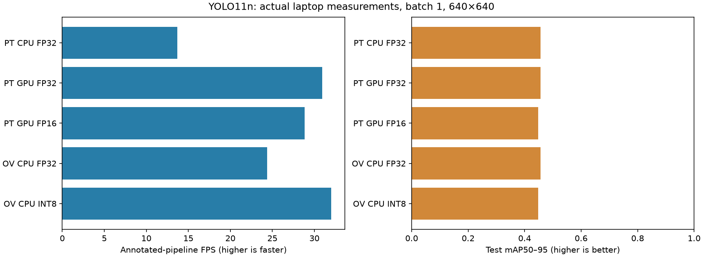

# Measured Results

Author: Kartik Sakhuja

All results below use the custom grouped test split. Distance accuracy is unmeasured because no object-distance ground truth is available.

## Detection and optimization

| Runtime | mAP50 | mAP50–95 | Detector FPS | Annotated-pipeline FPS | p95 pipeline latency (ms) | Artifact (MiB) |
|---|---:|---:|---:|---:|---:|---:|
| PyTorch CPU FP32 | 0.7135 | 0.4567 | 14.42 | 13.68 | 88.38 | 5.23 |
| PyTorch GPU FP32 | 0.7136 | 0.4567 | 34.84 | 30.92 | 38.71 | 5.23 |
| PyTorch GPU FP16 | 0.7116 | 0.4477 | 32.31 | 28.84 | 50.89 | 5.23 |
| OpenVINO CPU FP32 | 0.7135 | 0.4567 | 26.32 | 24.37 | 51.06 | 10.31 |
| OpenVINO CPU INT8 | 0.7088 | 0.4478 | 35.51 | 32.01 | 39.32 | 3.27 |

Artifact size includes XML/BIN/metadata for OpenVINO. The PyTorch checkpoint is shared by CPU/GPU and FP32/FP16 inference; serialized checkpoint size does not imply compute precision.

## Baseline per-class accuracy

| Class | Precision | Recall | AP50 | AP50–95 |
|---|---:|---:|---:|---:|
| cone | 0.7550 | 0.5377 | 0.6052 | 0.2909 |
| barrier | 0.6624 | 0.5182 | 0.5517 | 0.2890 |
| stop_sign | 0.8778 | 1.0000 | 0.9839 | 0.7902 |

AP evaluation uses confidence floor 0.001, IoU-NMS 0.7, maximum 50 detections and batch 1. Precision/recall above use the framework's best mean-F1 confidence; they are not scores at the fixed 0.25 demo/timing threshold.

OpenVINO INT8 versus OpenVINO FP32: **1.31×** annotated-pipeline speed ratio, with **-0.0089** absolute mAP50–95 change. Quantization uses 320 training-only images. A speed ratio below 1 means INT8 was slower on this hardware.

## Measurement conditions

Batch 1, 640×640, identical 16 preloaded test frames, confidence 0.25, IoU 0.7, max 50 detections, 20 warmups, 3×100 timed iterations. Detector timing covers preprocessing, network and NMS. Pipeline timing also covers geometry and drawing. CUDA synchronization is included. Loading, disk I/O, image/video decoding and encoding are excluded. Laptop power and thermals affect timings; these are not measurements on a deployed robot or Jetson.

PyTorch/OpenCV use 4 CPU threads. OpenVINO uses its LATENCY-mode runtime thread settings, recorded in each benchmark JSON. Compare OpenVINO FP32/INT8 to isolate quantization within the same runtime; comparing PyTorch/OpenVINO also changes runtime.

Hardware: GPU **NVIDIA GeForce RTX 2050**; host **AMD Ryzen 7 7435HS**; 16 logical CPUs.

Stop-sign test data contains just 18 boxes, selected with a pretrained teacher and visually reviewed. This coverage and the lack of wholly negative scenes limit the strength of the accuracy claims. Dataset labels can miss incidental signs. Depth uses supplied calibration/flat-road assumptions or explicit size/FOV priors and is not validated against real distances.

Training completed 30 epochs; final logged elapsed time 37.0 minutes. Best checkpoint was selected using validation fitness.

Free disk space when report generated: 22.20 GiB. Original downloaded archives remain intact.
